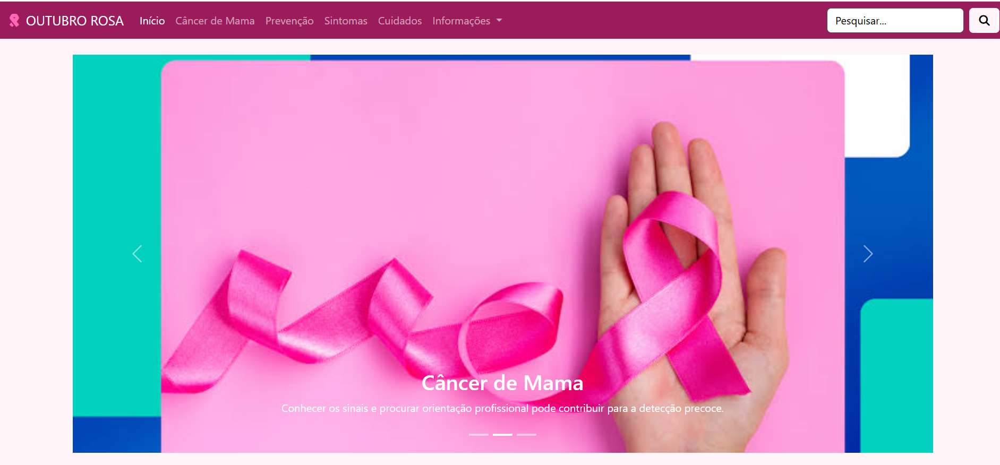

# 🌸 Site Outubro Rosa

## 📌 Visão Geral

O Site Outubro Rosa é um projeto acadêmico desenvolvido durante a graduação em Engenharia de Software na UDF.

O objetivo é divulgar informações sobre a campanha Outubro Rosa, promovendo a conscientização sobre a importância da prevenção e do diagnóstico precoce do câncer de mama.

## 🛠️ Tecnologias Utilizadas

- HTML5
- CSS3
- Bootstrap 5
- JavaScript
- Font Awesome

## ⚙️ Funcionalidades

- Menu de navegação.
- Carrossel de imagens.
- Conteúdos informativos sobre a campanha.
- Campo de pesquisa.
- Layout visual responsivo.

## ▶️ Como executar

1. Clone este repositório:

   `git clone https://github.com/arthurbezerra868-oss/Site-Outubro-Rosa.git`

2. Abra a pasta do projeto.
3. Execute o arquivo `index.html` em seu navegador.

Não é necessário instalar dependências adicionais.

## 📷 Demonstração

As imagens e os recursos visuais utilizados no projeto estão disponíveis nas pastas `img`, `css` e `fontawesome-free-7.3.1-web`.

## 👨‍💻 Autor

**Arthur Lima Bezerra**

Estudante de Engenharia de Software – UDF.

- GitHub: https://github.com/arthurbezerra868-oss
- LinkedIn: https://www.linkedin.com/in/arthur-lima-b80b7542b/
- E-mail: arthurbezerra868@gmail.com

## 📄 Licença

Este projeto está sob a licença MIT. Consulte o arquivo LICENSE para mais informações.
